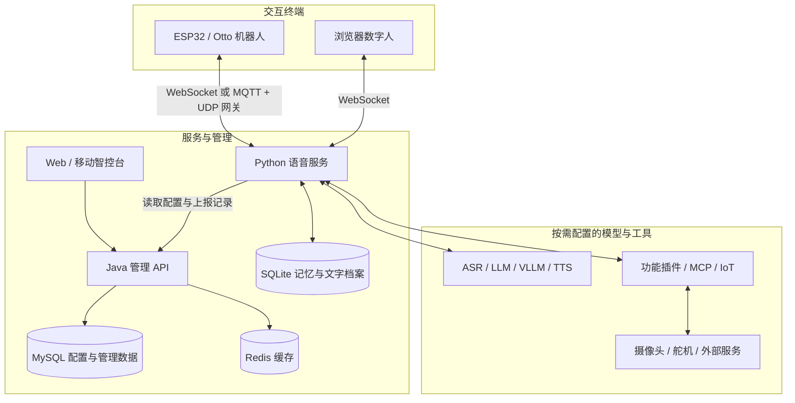

<p align="center">
  
</p>

<h1 align="center">小智语音交互与陪伴机器人平台</h1>

<p align="center">
  xiaozhi-esp32-server<br>
  实时语音对话 · 本地长期记忆 · 角色故事 · MCP 工具 · Otto 机器人
</p>

<p align="center">
  <a href="#项目概览">项目介绍</a> ·
  <a href="#功能介绍">功能介绍</a> ·
  <a href="#部署文档">部署与启动</a> ·
  <a href="#文档导航">文档导航</a> ·
  <a href="docs/FAQ.md">常见问题</a> ·
  <a href="LICENSE">MIT License</a>
</p>

## 项目概览

本项目是一套面向 ESP32 智能终端、Otto 机器人和浏览器数字人的语音交互平台。它将语音识别、大模型对话、语音合成、设备控制和管理后台串联起来，支持在自己的电脑或服务器上部署，也可以按需接入云端模型服务。

仓库基于 [xinnan-tech/xiaozhi-esp32-server](https://github.com/xinnan-tech/xiaozhi-esp32-server) 扩展，兼容 [xiaozhi-esp32](https://github.com/78/xiaozhi-esp32) 终端。在上游的语音服务与智控台基础上，本仓库增加了本地长期记忆、海绵宝宝角色故事、语音动作教学、摄像头直接调用、视觉接近演示，以及 Windows 日常启动脚本和 Otto 屏幕适配。

一次交互可以从“和机器人说句话”开始，也可以延伸为跨会话陪伴和硬件控制：

- **语音助手**：进行多轮聊天，查询天气、新闻，联网搜索，调用计算器或知识库。
- **陪伴交互**：记住用户的偏好、关系、计划和经历，支持纠正记忆、回顾往事与继续角色故事。
- **机器人演示**：通过 MCP 拍照观察环境，口述并保存动作步骤，按名称执行动作，演示逐帧观察后的有限步数接近。
- **开发与管理**：使用 Web 或移动智控台配置用户、设备、智能体、模型、音色、插件和固件。

本项目支持本地与云端组件混合使用。数据保存在本地，并不意味着所有推理都离线运行；文字、语音和图片的处理位置取决于实际选择的模型服务。

## 目录

- [功能介绍](#功能介绍)
- [系统架构](#系统架构)
- [技术栈与目录结构](#技术栈与目录结构)
- [部署文档](#部署文档)
- [访问地址与设备接入](#访问地址与设备接入)
- [配置方式](#配置方式)
- [模型与服务适配](#模型与服务适配)
- [开发与验证](#开发与验证)
- [数据维护与故障排查](#数据维护与故障排查)
- [文档导航](#文档导航)
- [开源来源与致谢](#开源来源与致谢)

## 功能介绍

### 实时语音与智能体管理

| 能力 | 说明 |
| --- | --- |
| 实时语音对话 | 接收设备音频，经过 VAD、ASR、LLM 和 TTS 返回语音，支持多轮上下文与语音打断。 |
| 多种通信方式 | 支持 WebSocket；MQTT + UDP 接入需要另外部署对应网关。 |
| 可替换模型 | 通过提供器适配语音识别、语言模型、视觉模型和语音合成，可组合本地服务与云端 API。 |
| 视觉交互 | 通过视觉接口和摄像头 MCP 工具分析图片，回答画面相关问题。 |
| 工具与插件 | 支持函数调用、设备 IoT、设备 MCP、服务端 MCP 与 MCP 接入点，统一调度外部能力。 |
| 声纹识别 | 配合声纹服务注册、管理和识别说话人，为对话提供身份信息。 |
| 知识库与动态上下文 | 可接入 RAGFlow，并通过 Context Provider 为智能体补充外部信息。 |
| Web 智控台 | 管理用户、设备、智能体、模型提供商、音色、声纹、知识库、OTA 和系统参数；支持多语言界面。 |
| 智能体配置管理 | 支持角色模板、标签和历史快照，可查看配置变化并恢复历史版本。 |
| 聊天记录 | 支持会话历史、聊天记录下载和音频记录；本地记忆页另提供按设备查看的文字档案。 |
| 移动智控台 | 基于 uni-app，提供 H5、微信小程序及 App 构建入口。 |
| 设备互呼 | 配合兼容终端与通讯录配置，实现设备之间的呼叫。 |
| 数字人入口 | 在浏览器中联调语音交互，可选配本地唤醒词，也可部署到一体机展示。 |

声纹、知识库、设备互呼、视觉和机器人控制均有各自的服务或终端要求，具体配置见[文档导航](#文档导航)。

### 本地长期记忆

本仓库默认启用本地长期记忆，单服务和智控台部署都可以使用。聊天原文与提取出的记忆保存在 SQLite 中，无需额外部署向量数据库或嵌入模型。

- **按设备保存**：即使多个设备绑定同一智能体，新产生的个人记忆仍按设备隔离，重连或重启后可继续读取。
- **保留来源**：聊天原文即时保存，模型在后台提取事实；可以从记忆追溯到相关原话。
- **自然语言管理**：支持记住、查看、纠错和忘记；对象不明确时会进一步询问。
- **区分变化与纠错**：保留事实随时间变化的记录；明确纠错后，旧内容不再作为有效事实参与回忆。
- **失败后重试**：提取失败保留待处理原文，后续会话或重新连接时继续处理。
- **适时关心**：在后续聊天中结合计划和约定提供关心建议；不会在无人聊天时主动唤醒设备。

可以直接说：“记住，我的猫叫奶茶”“你记得我什么”“你记错了，我的猫叫布丁”“忘掉关于我的猫叫什么的记忆”。

管理页面为 `http://localhost:8003/memory/`，支持搜索、查看来源、编辑、忘记和浏览聊天原文。这里的“忘记”表示停止召回相关内容，原始聊天档案仍然保留。Docker 或局域网访问需要配置独立管理口令。

详见[本地长期记忆](docs/local-long-term-memory.md)。

### 海绵宝宝角色与原创故事

角色身份、人物关系与初始故事资料位于 `main/xiaozhi-server/characters/spongebob.json`。机器人可以用海绵宝宝的身份讲述比奇堡原创日常，保存故事，并在以后继续讲述。

- “讲一个你在蟹堡王的新日常。”——创作并保存新故事。
- “继续上次那个纸风车的故事。”——检索已有故事并追加续篇。
- “还记得上次的故事吗？”——回顾已有内容。

角色故事使用独立数据表，与用户的现实经历分别管理。记忆页面的“角色故事”页签支持补充、编辑、查看来源和忘记。初始故事是本项目提供的原创内容，不能当作动画官方剧情或用户真实经历。

详见[角色故事](docs/character-stories.md)。

### MCP 工具与摄像头

| 方式 | 典型用途 | 配置入口 |
| --- | --- | --- |
| Python 功能插件 | 天气、新闻、联网搜索、音乐、角色切换、知识库检索 | `plugins_func/functions/` 与智能体功能配置 |
| 设备 IoT / MCP | 控制终端上报的音量、屏幕、舵机等能力 | 终端固件及设备工具列表 |
| 服务端直连 MCP | 连接本地或远程 MCP 服务 | `data/.mcp_server_settings.json` |
| WebSocket MCP 接入点 | 接入计算器、独立摄像头等外部工具桥接器 | 智控台 MCP 接入点配置 |

仓库附带本地 MCP 服务，提供算术计算、北京时间和状态查询；另有 WebSocket 接入点与计算器部署示例。这两种 MCP 部署使用不同协议与地址，不能直接互换。

摄像头支持明确拍照请求的直接路由：例如“拍张照看看前面有什么”会刷新工具列表并调用可用摄像头。询问是否具备拍照能力只检查工具；获取画面失败时会说明失败情况。独立摄像头固件及桥接程序需要另行准备。

详见[本地 MCP](main/xiaozhi-server/local-mcp/README.md)、[本机 MCP 接入点与摄像头联调](main/xiaozhi-server/mcp-endpoint/README.md)和[视觉模型接入](docs/mcp-vision-integration.md)。

### 语音教动作

用户可以一次口述完整步骤，保存为有名称的动作，之后直接按名称执行：

> “教你一个动作叫打招呼：先前进两步，然后等待两秒，最后挥手一次。”
>
> “复述动作打招呼。”
>
> “执行动作打招呼。”
>
> “停下。”

支持前进、后退、左右转、手部动作、坐下、站起或复位、等待与停止，具体取决于硬件提供的工具。教学时只保存和复述，执行时逐步发送指令，等待设备回到 idle 后继续；支持修改、删除、跨重连读取和中途停止。

每条动作最多 12 项，运动合计最多 30 步或次，等待合计最多 30 秒，总执行时间最多两分钟。当前使用步数和次数，不自动换算米数或角度；固定动作需要从相同起点和朝向开始。功能已有模拟硬件测试，实际步长、转向和舵机支持需要实机确认。

详见[语音动作教学](docs/voice-action-teaching.md)。

### 视觉寻物与寻药演示

“帮我拿感冒药”等明确请求可进入专用视觉接近流程：拍照确认目标位置，每次只转向或前进一步，等待动作完成后重新观察，达到停止条件后停下。动作教学与视觉接近共用会话运动锁，支持停止和语音打断。

当前演示可通过配置将目标名称对应到不同颜色的容器；普通观察问题只识别和播报，不触发行走。目标丢失、通路不明、工具异常或达到次数与时间上限时会结束流程并发送停止。

**实现范围是移动到目标前方并停下，尚未实现抓取、深度测距、建图或可靠避障。** 颜色映射是演示约定，不能用于确认真实药品身份；停止距离也需要根据摄像头安装和设备步长标定。已有模拟控制测试与真实拍照识别记录，完整行走效果仍需实机验证。

详见[视觉寻药演示与标定](docs/medicine-navigation.md)。

### 语音处理与 Otto 屏幕适配

本仓库为本地模型增加了上下文预算、历史裁剪和请求排队，减少聊天与后台记忆任务争用模型资源。GPT-SoVITS v2 适配支持分块 WAV、重采样、Opus 编码，以及打断时取消模型流和合成请求。

分块流式合成是否适合使用，取决于本机实际生成速度。当前笔记本部署已将 GPT-SoVITS 设为 `streaming_mode=0`，按文本段完成合成后播放；代码仍保留流式能力。具体配置变化与测量口径见[语音延迟记录](docs/voice-latency.md)。

`firmware/otto-display/` 保存特定 Otto 无摄像头版本的屏幕补丁与构建入口，提供较大中文字体、两行字幕分页和“正在听／正在想／正在说”状态提示。状态提示通过终端能力协商启用，需使用对应固件。该目录提供适配补丁，完整固件源码与 SDK 需要另外准备，详见[Otto 屏幕适配](firmware/otto-display/README.md)。

## 系统架构



单服务部署可以仅运行 Python 服务及所需模型；Java API、智控台、MySQL 和 Redis 用于全模块管理。图中的 MQTT + UDP 网关、独立摄像头及外部模型服务需要按所选方案另外部署。

语音交互的主要处理过程：

1. 终端采集音频，通过通信链路发送到 Python 服务。
2. VAD 检测语音，ASR 将音频转换为文字，可并行识别声纹。
3. 服务检索相关记忆与故事，处理明确的记忆、动作或摄像头请求，必要时调用工具。
4. LLM 生成回答，TTS 合成音频，编码后返回终端播放；用户可发起打断。
5. 聊天原文即时保存，后台在空闲时提取长期记忆；智控台模式可另行上报聊天记录。

## 技术栈与目录结构

| 模块 | 主要技术 | 职责 |
| --- | --- | --- |
| `xiaozhi-server` | Python 3.10、asyncio、WebSocket、aiohttp、Opus、SQLite | 语音会话、模型适配、工具调度、长期记忆与视觉接口 |
| `manager-api` | Java 21、Spring Boot 3.4、MyBatis-Plus、Shiro、Liquibase | 管理 API、鉴权、配置、设备、知识库与聊天记录 |
| `manager-web` | Vue 2、Vue CLI 5、Element UI、Vuex | Web 智控台 |
| `manager-mobile` | Vue 3、TypeScript、uni-app、Vite、Pinia | 移动智控台 |
| `digital-human` | HTML / JavaScript、Python、Sherpa-ONNX | 浏览器交互页面、本地唤醒词与事件桥 |
| 部署与硬件 | Docker Compose、PowerShell、ESP-IDF | 服务编排、Windows 启动和 Otto 固件适配 |

```text
xiaozhi-esp32-server/
├── README.md                       # 项目主页
├── Start-Xiaozhi.ps1                # 当前 Windows 部署的日常启动与检查
├── Dockerfile-server               # Python 服务镜像
├── Dockerfile-server-base          # Python 基础依赖镜像
├── Dockerfile-web                  # Java API 与 Web 智控台镜像
├── docs/                           # 部署、集成与功能专题文档
├── firmware/
│   └── otto-display/               # Otto 屏幕补丁与构建脚本
└── main/
    ├── xiaozhi-server/
    │   ├── app.py                  # Python 服务入口
    │   ├── config.yaml             # 默认配置与提供器示例
    │   ├── config_from_api.yaml    # 智控台模式配置模板
    │   ├── core/                   # 会话、协议、模型、记忆与工具实现
    │   ├── plugins_func/           # Python 功能插件
    │   ├── characters/             # 角色资料与初始原创故事
    │   ├── data/                   # 本地配置和持久化数据，部署时生成
    │   ├── models/                 # 本地模型目录，权重需另行准备
    │   ├── local-mcp/              # Streamable HTTP MCP 工具示例
    │   ├── mcp-endpoint/           # WebSocket MCP 接入点与计算器
    │   ├── robot-navigation/       # 视觉接近配置、桥接适配与验证脚本
    │   └── tests/                  # Python 测试
    ├── manager-api/                # Java 管理后端
    ├── manager-web/                # Web 智控台
    ├── manager-mobile/             # 移动智控台
    └── digital-human/              # 数字人页面及唤醒词运行时
```

本机 `.runtime/` 下的模型服务、虚拟环境、固件工作副本和实验记录不随仓库分发。下载源码后，需要按部署方式准备对应运行时与模型权重。

## 部署文档

### 选择运行方式

| 方式 | 需要运行的组件 | 适合场景 | 详细说明 |
| --- | --- | --- | --- |
| 单服务 | Python 服务与所选模型 | 体验语音、记忆和工具，自行维护 YAML 配置 | [单服务 Docker / 源码部署](docs/Deployment.md) |
| 全模块 | Python、Java API、Web、MySQL、Redis | 多用户、多设备、多智能体与图形化管理 | [全模块 Docker / 源码部署](docs/Deployment_all.md) |
| 现有 Windows 部署 | 已配置的 Docker 服务、LM Studio、GPT-SoVITS，可选 MCP | 当前笔记本开机后恢复整套服务 | [Windows 启动流程](docs/windows-startup.md) |

本地 ASR、语言模型、视觉模型和 TTS 的资源占用差异较大，应结合具体模型安排内存与显存。单服务不需要 MySQL 和 Redis；使用云端模型时需要配置自己的接口地址和密钥。

### 单服务源码启动

以下命令从仓库根目录开始，使用 Python 3.10 环境：

```bash
conda create -n xiaozhi-esp32-server python=3.10 -y
conda activate xiaozhi-esp32-server
conda install libopus ffmpeg -y

cd main/xiaozhi-server
pip install -r requirements.txt
```

安装完成后：

1. 创建 `main/xiaozhi-server/data/.config.yaml`，参考[配置方式](#配置方式)填写所选模型与服务地址。已有配置应直接编辑并保留原内容。
2. 使用默认本地 FunASR 时，按[模型下载说明](docs/Deployment.md#模型文件)准备 SenseVoiceSmall 权重，将 `model.pt` 放入 `models/SenseVoiceSmall/`；其他本地提供器也需要各自的模型文件。
3. 先启动所依赖的本地模型服务，或确认云端 API 配置可用，再在 `main/xiaozhi-server` 目录运行：

```bash
python app.py
```

启动后查看日志中的 WebSocket、OTA 和视觉接口地址。需要浏览器交互时，另行启动数字人模块。

### 全模块 Docker 部署

仓库中的 `docker-compose_all.yml` 默认引用上游预构建镜像。**运行本仓库新增的 Python 功能时，应同时使用 `docker-compose.memory.yml` 构建当前源码。** 该覆盖文件只替换 Python 后端构建，同时固定现有部署使用的基础镜像与 MySQL 版本；接入已有数据库前应核对数据版本。

先按[全模块部署说明](docs/Deployment_all.md)准备配置、模型及持久化目录，再在 `main/xiaozhi-server` 中启动管理组件：

```bash
docker compose -f docker-compose_all.yml -f docker-compose.memory.yml up -d xiaozhi-esp32-server-db xiaozhi-esp32-server-redis xiaozhi-esp32-server-web
```

数据库、缓存和 Java API 就绪后，完成以下配置：

1. 打开 `http://localhost:8002/`，首次注册的账号为管理员。
2. 在智控台配置模型、智能体和设备，取得“参数管理”中的 `server.secret`。
3. 参考 `config_from_api.yaml` 设置 `data/.config.yaml`。Docker 内的管理接口地址使用 `http://xiaozhi-esp32-server-web:8002/xiaozhi`，并填入对应密钥。
4. 在本地配置中设置 `local_memory.management_token`，供记忆管理页访问使用。

然后构建并启动 Python 服务：

```bash
docker compose -f docker-compose_all.yml -f docker-compose.memory.yml up -d --build --no-deps xiaozhi-esp32-server
docker compose -f docker-compose_all.yml -f docker-compose.memory.yml logs -f --tail 100 xiaozhi-esp32-server
```

后续更新 Python 代码继续使用这两个 Compose 文件。Java 或 Web 的本地修改需要另行构建并替换智控台镜像，构建入口见 [Docker 镜像构建](docs/docker-build.md)；仅重建 Python 镜像不会更新管理端。移动端也需要单独构建。

本地 MCP 和 MCP 接入点各有独立 Compose 文件，全模块命令不会自动配置这两项。按对应专题文档完成接入后，设备重新连接以加载工具。

### 当前 Windows 部署的日常启动

`Start-Xiaozhi.ps1` 用于恢复本机已经配置好的服务，不负责从零安装全部依赖。它会等待 Docker 引擎、数据库与缓存，启动管理端、Python 后端和可选 MCP，并补齐本机 GPT-SoVITS 与 LM Studio 服务。

在仓库根目录执行：

```powershell
# 日常启动
.\Start-Xiaozhi.ps1

# 仅检查当前就绪状态
.\Start-Xiaozhi.ps1 -CheckOnly

# Python 代码更新后重新构建
.\Start-Xiaozhi.ps1 -Build

# 启动后打开智控台和记忆页面
.\Start-Xiaozhi.ps1 -OpenPages
```

可使用 `-SkipMcp` 跳过 MCP，`-SkipLlm` 跳过本机 LM Studio 启动与检查，`-TimeoutSeconds 600` 延长等待时间。当前脚本使用 `qwen/qwen3.5-9b`、16K 上下文和本机海绵宝宝 GPT-SoVITS 运行时；更换机器时需要调整这些依赖。

数字人页面与独立摄像头桥接器需要另行启动。完整操作、健康检查范围和网络变化处理见 [Windows 启动流程](docs/windows-startup.md)。

### 浏览器数字人

准备好唤醒词模型及配置后，在独立终端中启动：

```bash
cd main/digital-human
pip install -r wakeword_runtime/requirements.txt
python start.py
```

访问 `http://127.0.0.1:8006/index.html`，配置后端地址并允许麦克风访问，即可联调语音交互。本地唤醒词可以按需禁用；模型下载和音频设备配置见[数字人唤醒词说明](docs/digital-human-wakeword.md)。

## 访问地址与设备接入

以下为默认端口，实际以配置和启动日志为准。`localhost` 仅指正在访问服务的这台电脑。

| 服务 | 默认地址或端口 | 用途 |
| --- | --- | --- |
| 设备 WebSocket | `ws://<服务端IP>:8000/xiaozhi/v1/` | ESP32、Otto 和数字人的语音连接 |
| Web 开发服务器 | `http://localhost:8001/` | `manager-web` 源码开发 |
| 智控台 / 管理 API | `http://localhost:8002/` / `/xiaozhi` | Docker 智控台与 Java API；源码模式前端使用 8001 |
| API 文档 | `http://localhost:8002/xiaozhi/doc.html` | Java 接口说明 |
| 本地记忆管理 | `http://localhost:8003/memory/` | 设备记忆、角色故事与聊天文字档案 |
| 视觉分析 | `http://<服务端IP>:8003/mcp/vision/explain` | 图片分析接口 |
| 单服务 OTA | `http://<服务端IP>:8003/xiaozhi/ota/` | Python 单服务模式下发连接信息 |
| 全模块 OTA | `http://<服务端IP>:8002/xiaozhi/ota/` | 智控台模式设备接入与 OTA |
| 本地 MCP | `http://127.0.0.1:8004/health`、`/mcp` | 可选的健康检查与 Streamable HTTP MCP |
| MCP 接入点 | `8005` | 可选的 WebSocket 中转，完整地址由接入点配置提供 |
| 数字人 | `http://127.0.0.1:8006/index.html` | 浏览器语音入口，健康检查为 `/health` |
| LM Studio | `http://127.0.0.1:1234/v1` | 当前本机语言模型接口 |
| GPT-SoVITS | `http://127.0.0.1:9880/docs` | 当前本机语音合成接口文档 |

ESP32 应使用服务电脑的实际局域网 IP，不能填写 `localhost`。在设备配网页面设置对应部署模式的 OTA 地址，让设备与服务电脑网络互通，再在智控台完成设备绑定。具体步骤见[固件配置](docs/firmware-setting.md)。

Docker 容器访问 Windows 宿主机的模型服务时，通常使用 `host.docker.internal`，同时需要模型服务允许容器网络访问。WebSocket 地址通过协议客户端连接，不能当作普通网页打开。

## 配置方式

### 单服务与智控台的配置来源

| 场景 | 配置规则 |
| --- | --- |
| 单服务 | 读取 `config.yaml` 默认值，由 `data/.config.yaml` 递归覆盖同名配置。 |
| 智控台模式 | 当本地配置填写了 `manager-api.url`，模型、智能体等配置由 Java API 提供，在智控台修改。 |
| 本机扩展 | `local_memory`、`medicine_navigation` 在两种模式下均保留本地默认值与覆盖配置；服务监听和视觉地址等也由本地配置控制。 |
| MCP 直连 | `data/.mcp_server_settings.json` 保存服务端 MCP 连接设置。 |

修改部署配置时优先编辑 `data/.config.yaml`，不要把个人密钥写入默认模板。按配置类型重启相关服务或让设备重新连接，以加载更新。

### 单服务配置示例

下面示例使用本地 FunASR、LM Studio 和 EdgeTTS。需要提前下载 ASR 权重，在 LM Studio 加载同名模型并启动接口；`context_window` 应与模型实际加载的上下文一致。EdgeTTS 需要网络访问。

将以下内容合并到 `main/xiaozhi-server/data/.config.yaml`，替换 IP、模型与管理口令：

```yaml
server:
  ip: 0.0.0.0
  port: 8000
  http_port: 8003
  websocket: ws://192.168.1.100:8000/xiaozhi/v1/
  vision_explain: http://192.168.1.100:8003/mcp/vision/explain

selected_module:
  VAD: SileroVAD
  ASR: FunASR
  LLM: LocalLLM
  TTS: EdgeTTS
  Intent: nointent

LLM:
  LocalLLM:
    type: openai
    base_url: http://127.0.0.1:1234/v1
    model_name: qwen/qwen3.5-9b
    api_key: lm-studio
    context_window: 16384
    serialize_requests: true

local_memory:
  enabled: true
  database_path: data/long_term_memory.sqlite3
  management_token: "请替换为自己的独立管理口令"
```

该示例先启用普通语音对话与本地记忆。需要模型调用 MCP 或功能插件时，将 `Intent` 改为 `function_call`，选择支持工具调用的模型，并配置对应工具。需要图像理解时另外配置 `selected_module.VLLM` 与视觉提供器。

本地长期记忆默认优先于 `selected_module.Memory`。若要使用原有 `mem_local_short`、Mem0 或 PowerMem 等模式，需要将 `local_memory.enabled` 设为 `false`，再选择对应 Memory 提供器。

## 模型与服务适配

以下按代码中的提供器列出代表性接入方式，具体字段以 `config.yaml` 和各专题文档为准。服务可用性、接口兼容性和费用由所选服务决定。

| 模块 | 接入方式与代表性组件 |
| --- | --- |
| VAD | 本地 SileroVAD。 |
| ASR 语音识别 | 本地 FunASR / SenseVoiceSmall、Sherpa-ONNX、Vosk；FunASR 服务端；阿里、火山、讯飞、腾讯、百度、OpenAI 兼容接口等。部分提供器支持流式识别。 |
| LLM 语言模型 | OpenAI 兼容接口、LM Studio、Ollama、Gemini、Dify、FastGPT、Coze、Xinference、阿里百炼应用、Home Assistant。 |
| VLLM 视觉模型 | 通过 OpenAI 兼容的视觉模型接口接入，按所选服务配置图片输入与模型名称。 |
| TTS 语音合成 | EdgeTTS、阿里、火山、讯飞、腾讯、MiniMax、OpenAI 兼容接口等；本地服务支持 GPT-SoVITS v2/v3、Fish Speech、Index-TTS、PaddleSpeech 等。 |
| 声纹 | 通过 3D-Speaker 服务接入，配合智控台进行注册与管理。 |
| 记忆 | 本仓库的 SQLite 长期记忆；原有短期摘要、Mem0、PowerMem 与无记忆模式。 |
| 知识库 | RAGFlow，通过检索工具结合知识库内容回答。 |

普通聊天、工具调用、视觉理解和结构化记忆提取对模型能力有不同要求。切换模型时，应分别检查实际使用的交互路径。

## 开发与验证

### 各模块开发入口

以下命令分别在对应模块目录执行，并先完成依赖安装与环境配置：

| 目录 | 启动或构建命令 | 环境说明 |
| --- | --- | --- |
| `main/xiaozhi-server` | `python app.py` | Python 3.10、`requirements.txt`、FFmpeg、libopus 与所选模型。 |
| `main/manager-api` | `mvn spring-boot:run` | JDK 21、Maven 3.8+，按 `application-*.yml` 配置数据库与 Redis。 |
| `main/manager-web` | `npm install`，`npm run serve`；构建用 `npm run build` | Vue 2 工程，开发端口 8001，代理到 Java API。 |
| `main/manager-mobile` | `pnpm install`，`pnpm dev:h5` 或 `pnpm dev:mp-weixin` | Node.js 18+，仓库声明 pnpm 10.10.0；配置 `env/` 下的 API 地址与 AppID。 |
| `main/digital-human` | `python start.py` | 依赖与模型参见该模块说明。 |

新增模型提供器放在 `core/providers/` 对应目录；新增 Python 功能插件放在 `plugins_func/functions/`，按现有注册方式与配置加载。外部能力也可以通过 MCP 接入。

### 测试入口

Python 测试在 `main/xiaozhi-server` 执行。安装应用依赖后，另行安装测试依赖：

```bash
pip install pytest pytest-asyncio freezegun
python -m pytest -q
```

核心测试覆盖记忆持久化与隔离、纠错删除、角色故事、管理接口、模型上下文、流式音频与打断、摄像头路由、动作教学和视觉接近。涉及硬件的控制测试使用模拟工具，不能代替实机验证。

其他模块分别提供以下命令：

| 模块 | 命令 |
| --- | --- |
| Java API | `mvn test -DskipTests=false`；POM 默认跳过测试，执行时需显式覆盖。 |
| Web 智控台 | `npm test`；快照相关检查为 `npm run test:snapshot`。 |
| 移动智控台 | `pnpm test:snapshot`、`pnpm type-check`。 |
| 本地 MCP | 在 `local-mcp` 目录执行 `docker compose exec xiaozhi-local-mcp python /app/verify.py`。 |
| MCP 接入点 | 在 `mcp-endpoint` 目录执行 `docker exec xiaozhi-mcp-calculator python /app/verify.py`。 |

性能测试可在 Python 模块目录运行 `python performance_tester.py`，使用实际配置的模型进行测量，详见[性能测试说明](docs/performance_tester.md)。已有本机测量的统计条件与限制见[语音延迟记录](docs/voice-latency.md)。

## 数据维护与故障排查

### 持久化与备份

| 数据 | 默认位置或保存方式 |
| --- | --- |
| Python 本地配置与 MCP 设置 | `main/xiaozhi-server/data/` |
| 本地聊天原文、长期记忆、角色故事、已学动作 | `data/long_term_memory.sqlite3`，路径可配置 |
| 智控台配置与管理数据 | MySQL；Compose 默认挂载 `main/xiaozhi-server/mysql/data/` |
| 管理端上传文件 | Compose 默认挂载 `main/xiaozhi-server/uploadfile/` |
| Python 日志 | 默认 `main/xiaozhi-server/tmp/server.log`，可在配置中调整 |

SQLite 离线备份应先停止 Python 服务再复制数据库；在线备份使用 SQLite backup API，避免遗漏 WAL 中的内容。MySQL 应使用适合所用版本的数据库备份方式。更新镜像前保留配置、数据库和上传文件，恢复时核对数据库版本。

本地记忆会按当前大模型配置，将提取或回答需要的文字发送到模型接口。准备对外提供服务时，应修改示例数据库凭据、设置独立记忆管理口令，并按需启用设备认证、HTTPS / WSS 与访问控制。

### 常见问题入口

| 现象 | 优先检查 |
| --- | --- |
| 智控台首页打开，但接口报错 | Java API 是否就绪、数据库与 Redis 是否健康；仅有 Nginx 首页不代表管理 API 已启动。 |
| ESP32 无法连接 | OTA 模式与地址、服务端局域网 IP、端口、防火墙、设备和电脑的网络互通情况。 |
| 更新代码后仍没有新功能 | 是否构建了当前源码；Python 本地扩展需使用覆盖 Compose，管理端修改需另外构建。 |
| Docker 无法访问模型 | 容器内地址是否使用宿主机可达地址，以及模型服务监听范围是否允许访问。 |
| 记忆页无法读取数据 | `local_memory.enabled`、HTTP 端口和管理口令；Docker 访问也需要配置口令。 |
| 记忆页没有设备 | 先让终端完成聊天，再刷新；新记忆按实际接入的设备保存。 |
| MCP 显示已连接却没有执行 | 工具是否已发现、设备是否已重新连接、模型是否支持并实际发出了工具调用。 |
| 更换 Wi-Fi 后工具失效 | 局域网 IP、设备 OTA 地址、MCP 接入点与摄像头桥接地址是否需要更新。 |
| 语音合成等待较久或断续 | 检查本地 TTS 日志、模型负载和实际生成速度，再选择合成模式。 |

更多排查步骤见 [FAQ](docs/FAQ.md)、[Windows 启动流程](docs/windows-startup.md)和各模块日志。

## 文档导航

| 主题 | 文档 |
| --- | --- |
| 部署与更新 | [单服务](docs/Deployment.md) · [全模块](docs/Deployment_all.md) · [Windows 日常启动](docs/windows-startup.md) · [镜像构建](docs/docker-build.md) · [源码部署运维](docs/dev-ops-integration.md) |
| 架构与模块 | [技术文档](main/README.md) · [管理 API](main/manager-api/README.md) · [Web](main/manager-web/README.md) · [移动端](main/manager-mobile/README.md) |
| 本地陪伴能力 | [长期记忆](docs/local-long-term-memory.md) · [角色故事](docs/character-stories.md) · [语音延迟与合成模式](docs/voice-latency.md) |
| 机器人 | [语音教动作](docs/voice-action-teaching.md) · [视觉寻药与标定](docs/medicine-navigation.md) · [Otto 屏幕适配](firmware/otto-display/README.md) |
| MCP 与视觉 | [本地 MCP](main/xiaozhi-server/local-mcp/README.md) · [本机接入点](main/xiaozhi-server/mcp-endpoint/README.md) · [接入点部署](docs/mcp-endpoint-integration.md) · [接入点启用](docs/mcp-endpoint-enable.md) · [视觉模型](docs/mcp-vision-integration.md) · [设备信息](docs/mcp-get-device-info.md) |
| 固件与设备 | [固件配置](docs/firmware-setting.md) · [固件构建](docs/firmware-build.md) · [OTA 升级](docs/ota-upgrade-guide.md) · [MQTT 网关](docs/mqtt-gateway-integration.md) · [设备互呼](docs/device-call-guide.md) |
| 数字人与一体机 | [模块说明](main/digital-human/README.md) · [唤醒词配置](docs/digital-human-wakeword.md) · [一体机部署](docs/all-in-one-digital-human-setup.md) |
| 模型与音色 | [Fish Speech](docs/fish-speech-integration.md) · [Index-TTS](docs/index-stream-integration.md) · [PaddleSpeech](docs/paddlespeech-deploy.md) · [火山音色克隆](docs/huoshan-streamTTS-voice-cloning.md) · [声纹](docs/voiceprint-integration.md) |
| 记忆与知识库集成 | [PowerMem](docs/powermem-integration.md) · [RAGFlow](docs/ragflow-integration.md) · [动态上下文](docs/context-provider-integration.md) |
| 功能插件 | [联网搜索](docs/web-search-integration.md) · [天气](docs/weather-integration.md) · [新闻](docs/newsnow_plugin_config.md) · [Home Assistant](docs/homeassistant-integration.md) |
| 测试与帮助 | [性能测试](docs/performance_tester.md) · [常见问题](docs/FAQ.md) · [致开发者的公开信](docs/contributor_open_letter.md) |

部分专题保留了上游通用部署说明，另一些记录了本机配置与验证结果。实际使用时，以当前源码、本地配置及对应功能文档为准。`docs/readme/` 中保留的其他语言版本尚未同步本仓库的扩展介绍。

## 开源来源与致谢

本仓库遵循 [MIT License](LICENSE)，保留上游版权声明。设备协议、模型、音色、素材和第三方服务分别遵循各自的许可或使用条款。

感谢 [xinnan-tech/xiaozhi-esp32-server](https://github.com/xinnan-tech/xiaozhi-esp32-server) 及其贡献者提供语音服务与智控台基础，感谢 [78/xiaozhi-esp32](https://github.com/78/xiaozhi-esp32) 提供终端生态。Otto 屏幕适配所用固件来源与固定版本见[固件说明](firmware/otto-display/README.md)。

同时感谢[百聆语音对话机器人](https://github.com/wwbin2017/bailing)、十方融海、玄凤科技、智控台移动端贡献者 huangjunsen、汇远设计、西安勤人信息科技，以及相关模型、MCP、音频处理和硬件开源项目的维护者。
