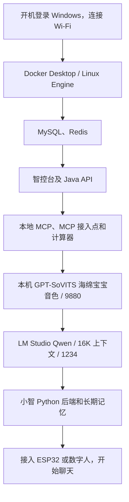

# Windows 笔记本：从开机到小智后端全部就绪

这份流程对应当前电脑的部署：小智、智控台、MySQL、Redis、本地 MCP、MCP 接入点和计算器都在 Docker 中运行；长期记忆随小智 Python 后端一起启动。海绵宝宝音色使用本机 GPT-SoVITS，聊天使用 LM Studio 的 Qwen，启动脚本会补齐这两个本机服务。项目位于 `F:\CQU\Project\xiaozhi\xiaozhi-esp32-server`。

## 每天开机后的操作

1. 开机并登录 Windows，连接平时使用的 Wi-Fi，确认项目所在的 `F:` 盘和 Docker 数据所在的 `E:` 盘都可以访问。
2. 打开 PowerShell，运行下面的启动脚本。Docker Desktop 尚未启动时，脚本会尝试打开它并等待引擎就绪。

```powershell
cd F:\CQU\Project\xiaozhi\xiaozhi-esp32-server
.\Start-Xiaozhi.ps1
```

3. 等待出现绿色的 `All selected backends are ready.`。脚本会检查数据库、智控台 API、小智后端、聊天模型、语音合成和 MCP；语音合成还会检查 Docker 中的小智能否访问本机接口。有错误会停止并指出失败环节。
4. 打开 [智控台](http://localhost:8002/) 和 [记忆管理页](http://localhost:8003/memory/)。记忆页“访问设置”中输入之前设置的管理口令并连接。
5. 接通或唤醒 ESP32，让设备与笔记本处于同一局域网，和小智说一句话。回到记忆页点击“刷新”，可查看设备及聊天记录；记忆提取在后台完成，稍后刷新可以看到长期记忆。

启动脚本结束后，可以关闭 PowerShell。Docker Desktop、LM Studio 及后台的 GPT-SoVITS Python 进程需要继续运行，笔记本应保持开机且不休眠。再次运行脚本会复用已有语音服务；如果它正在加载模型或忙于合成，脚本会检查实际运行进程并等待接口恢复，避免因旧 PID 文件失效而重复加载模型。

MCP 计算器的最终健康检查在小智与记忆后端启动之后执行；即使计算器异常，已经启动的核心服务仍保持运行。此时按下文处理 MCP 地址，再重新运行脚本。

## Docker 数据迁移到 E 盘后

当前 Docker WSL 数据目录为 `E:\Docker\wsl\DockerDesktopWSL`，其中 `disk\docker_data.vhdx` 保存容器与镜像数据，`main\ext4.vhdx` 是 Docker 的 WSL 系统磁盘。Docker Desktop 已在 `%APPDATA%\Docker\settings-store.json` 的 `CustomWslDistroDir` 中记录新位置。

启动脚本会读取这个设置，检查目录可访问，并打印 `Docker WSL data: E:\Docker\wsl\DockerDesktopWSL`。以后通过 Docker Desktop 的“Settings → Resources → Advanced”移动磁盘位置，脚本也会读取新的设置。若数据盘不可访问，脚本会提示具体目录。

Docker Desktop 程序目前仍安装在 `C:\Users\DELL\AppData\Local\Programs\DockerDesktop`。脚本会优先根据 `docker.exe` 的位置查找 `Docker Desktop.exe`，再检查常见安装目录。WSL 数据目录中不需要放置启动程序。

日常仍运行 `.\Start-Xiaozhi.ps1`。项目、数据库绑定目录和配置文件仍位于 `F:\CQU\Project\xiaozhi\xiaozhi-esp32-server`，Compose 中的项目挂载路径继续使用原位置。ESP32 视觉 MCP 的 `CameraWebServer\mcp_server\start_mcp.ps1` 运行的是 Windows Python 桥接，无需随 Docker 虚拟磁盘迁移修改路径。

## 启动顺序与各个服务



| 服务 | 地址或用途 | 就绪判断 |
|---|---|---|
| MySQL | 保存智控台配置与聊天数据 | Docker health 为 healthy |
| Redis | 缓存等后台功能 | Docker health 为 healthy |
| 智控台与 Java API | `http://localhost:8002/` | 公共配置 API 正常返回 |
| 小智 Python 后端 | `ws://笔记本局域网IP:8000/xiaozhi/v1/` | 容器运行、8000 端口已监听 |
| 长期记忆管理 | `http://localhost:8003/memory/` | 页面可访问 |
| 海绵宝宝语音合成 | 本机 `http://127.0.0.1:9880/docs`；Docker 通过 `host.docker.internal:9880` 访问 | 本机及小智容器均能读取 GPT-SoVITS 的 OpenAPI 接口 |
| Qwen 聊天模型 | LM Studio，`http://127.0.0.1:1234/v1` | 模型已加载，实际上下文为 16384 |
| 本地 MCP | `http://127.0.0.1:8004/health` | 健康接口返回 ok |
| MCP 接入点 | 8005 端口 | 容器运行 |
| MCP 计算器 | 通过接入点供小智调用 | 容器 health 的工具发现检查通过 |

语音服务使用 `.runtime/gpt-sovits-venv/Scripts/python.exe`，在 `.runtime/gpt-sovits` 中运行 `api_v2.py -a 127.0.0.1 -p 9880 -c GPT_SoVITS/configs/spongebob.yaml`，沿用已有模型和音色设置。相关运行时和音色文件保存在本机，不随 Git 仓库分发。

就绪检查不调用聊天模型，也不会每次启动都生成测试语音；它不能代替麦克风、语音识别与真实设备的对话测试。首次加载模型较慢时，可以使用 `.\Start-Xiaozhi.ps1 -TimeoutSeconds 600` 延长等待。

LM Studio 会通过本机 `lms.exe` 加载 `qwen/qwen3.5-9b`：上下文 16384、单并发、GPU 卸载比例 65%，为语音服务留出显存。智控台中该模型的 `context_window` 同样设为 16384。改用其他模型服务后，可加 `-SkipLlm` 跳过本机 Qwen 启动与检查。

## 常用命令

在项目根目录运行：

```powershell
# 日常启动：使用已有镜像，不重复构建。
.\Start-Xiaozhi.ps1

# 仅查看就绪状态，包括语音合成；不启动服务或修改容器。
.\Start-Xiaozhi.ps1 -CheckOnly

# 修改后端代码后，重建并启动本地记忆版镜像。
.\Start-Xiaozhi.ps1 -Build

# 启动小智、智控台、数据库、记忆和语音合成，不启动 MCP。
.\Start-Xiaozhi.ps1 -SkipMcp

# 启动完成后打开智控台和记忆页面。
.\Start-Xiaozhi.ps1 -OpenPages
```

这些命令不会清空数据库和记忆。启动脚本始终同时使用 `docker-compose_all.yml` 和 `docker-compose.memory.yml`，确保使用本地记忆版后端。

本机覆盖文件固定了原 Python 基础镜像和 MySQL 版本。当前 MySQL 为 `26.7.0`，与保留的数据目录中 `mysql_upgrade_history` 一致；恢复容器时应继续使用该版本，避免 `mysql:latest` 自动升级原有数据格式。

## 如果需要手工启动

先打开 Docker Desktop，等待引擎运行，再执行：

```powershell
cd F:\CQU\Project\xiaozhi\xiaozhi-esp32-server\main\xiaozhi-server

# 数据库、缓存和智控台；能正常登录智控台后继续。
docker compose -f docker-compose_all.yml -f docker-compose.memory.yml up -d xiaozhi-esp32-server-db xiaozhi-esp32-server-redis xiaozhi-esp32-server-web

# 本地 MCP。
cd .\local-mcp
docker compose up -d

# MCP 接入点及计算器。
cd ..\mcp-endpoint
docker compose up -d

# 本机 GPT-SoVITS 海绵宝宝语音合成；在后台运行。
cd ..
powershell.exe -NoLogo -NoProfile -ExecutionPolicy Bypass -File .\audio_ref\spongebob\start_tts.ps1

# LM Studio 本机服务和 Qwen；若已有同名模型以其他上下文加载，先在 LM Studio 卸载它。
& "$env:USERPROFILE\.lmstudio\bin\lms.exe" server start --port 1234
& "$env:USERPROFILE\.lmstudio\bin\lms.exe" load qwen/qwen3.5-9b --context-length 16384 --parallel 1 --gpu 0.65 --yes

# 小智 Python 后端及长期记忆。
docker compose -f docker-compose_all.yml -f docker-compose.memory.yml up -d --no-build --no-deps xiaozhi-esp32-server
docker ps
```

第一次部署或删除过本地镜像时，先使用启动脚本自动构建，或在 `main/xiaozhi-server` 目录执行带 `--build` 的原有启动命令。

## 更换 Wi-Fi 或局域网 IP 变化

`localhost` 管理页面仍用于笔记本自己访问。ESP32 使用笔记本局域网地址连接，MCP 接入点的现有配置也包含笔记本的局域网 IP。

若能打开网页，但 ESP32 连不上或计算器健康检查一直失败：

1. 执行 `ipconfig`，查看当前 Wi-Fi 适配器的 IPv4 地址。
2. 确认 ESP32 的 OTA/WebSocket 配置指向当前笔记本地址，并且设备与笔记本网络互通。
3. MCP 地址确实变化时，先在智控台登录管理员账号，再执行已有的配置脚本。把下面的地址替换成当前 Wi-Fi IPv4：

```powershell
cd F:\CQU\Project\xiaozhi\xiaozhi-esp32-server\main\xiaozhi-server\mcp-endpoint
.\Configure-Endpoint.ps1 -EndpointHost "当前笔记本的IPv4地址"
docker compose up -d --force-recreate calculator
```

4. 回到项目根目录，重新运行 `Start-Xiaozhi.ps1`，然后让小智重新连接。固定使用同一局域网并为笔记本设置路由器 DHCP 地址保留，可以减少地址变化。

修改 MCP 地址后还应重启小智后端，让它读取智控台的新配置：

```powershell
cd F:\CQU\Project\xiaozhi\xiaozhi-esp32-server\main\xiaozhi-server
docker compose -f docker-compose_all.yml -f docker-compose.memory.yml restart xiaozhi-esp32-server
cd ..\..
.\Start-Xiaozhi.ps1
```

本次整理时已将失效的 `172.17.230.9` 更新为当前 WLAN 地址 `10.68.63.9`，并验证计算器恢复健康。之后仍以 `ipconfig` 显示的实际地址为准。

## 如果使用笔记本数字人页面

数字人是另一个可选的交互入口，Docker 后端启动脚本不启动麦克风。使用你原来运行数字人的 Python 环境，另开终端执行：

```powershell
cd F:\CQU\Project\xiaozhi\xiaozhi-esp32-server\main\digital-human
python start.py
```

然后打开 `http://127.0.0.1:8006/index.html`，按原来的方式连接小智后端并启用麦克风。数字人的终端需要保持运行；直接使用 ESP32 时可以省略此步。

## 故障定位

- Docker 无法连接：先打开 Docker Desktop，等待 Linux Engine 就绪，再运行脚本。
- Docker 弹出 `An unexpected error occurred`，并在 `starting services` 后提示某个 `.sock` 无法访问：这是 Docker 自身的 Windows 运行端点问题。先退出 Docker 并保存工作，重启 Windows 后重试；不要用“恢复出厂设置”处理，以免清空镜像和容器数据。若重启后仍失败，保留弹窗中的具体路径及日志继续定位。
- MySQL 或 Redis 不健康：查看对应容器日志，脚本会在它们恢复前等待。
- 智控台失败：`docker logs --tail 80 xiaozhi-esp32-server-web`。
- 小智后端失败：`docker logs --tail 80 xiaozhi-esp32-server`。
- 语音合成失败：查看 `main/xiaozhi-server/audio_ref/spongebob/tts-error.log` 和 `tts-output.log`。此服务运行在 Windows Python 中，Docker 容器启动不会自动启动它；统一启动脚本现在会补齐这一步。若提示缺少本机运行时文件，先恢复原有 GPT-SoVITS 目录、虚拟环境及音色配置。
- 计算器失败：`docker logs --tail 60 xiaozhi-mcp-calculator`，并检查上面的 IP 变化步骤。
- 记忆页设备为空：先连接/唤醒小智并完成聊天，再点“刷新”；它显示接入本地记忆的设备记录。

Docker Desktop 启动后，现有容器会按重启策略尝试恢复。启动脚本会按顺序补齐服务并确认就绪；本文没有修改 Windows 的开机启动设置。
